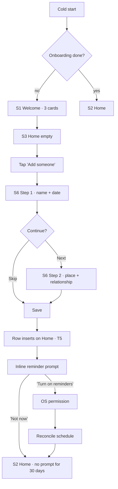
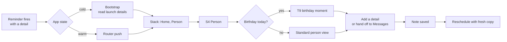
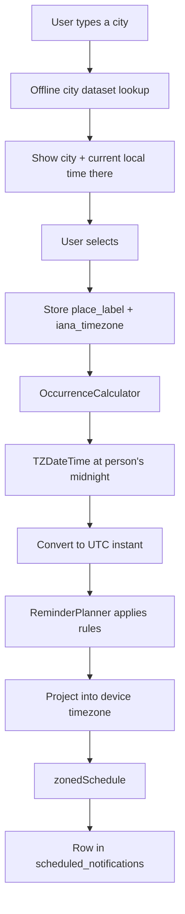
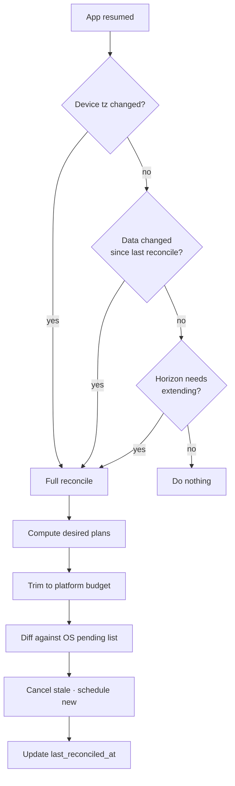
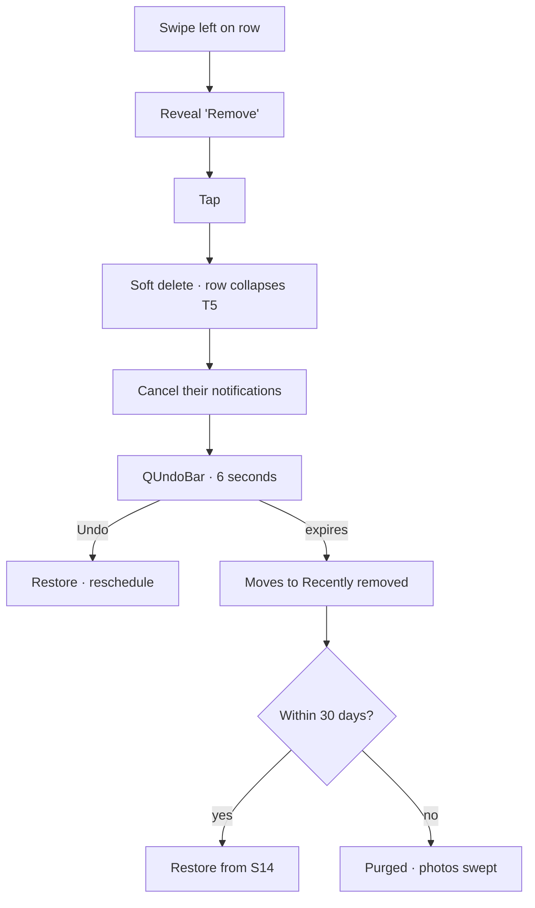
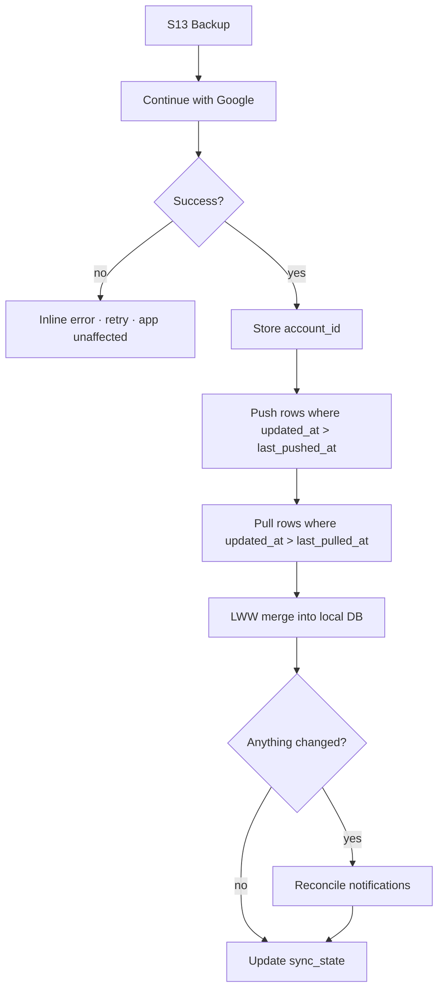
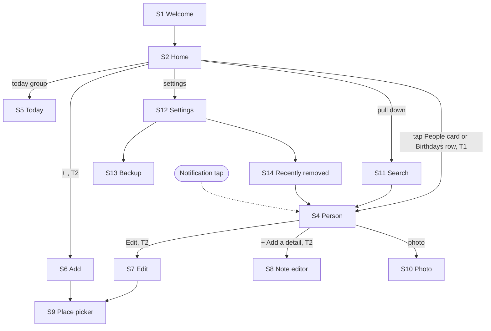

# 12 — Screen Map & User Flows

> **Implementation status:** S1–S14 are target product surfaces for Phases 4–7.
> None is implemented yet. The current runtime has no product router and opens
> the Phase 1 `GalleryScreen`, which is a design-review surface rather than a
> product screen or route from this map.

## 1. Complete screen inventory

Fourteen surfaces. That is the whole product.

| # | Surface | Type | Route | Purpose |
|---|---|---|---|---|
| S1 | Welcome | Full screen | `/welcome` | Three quiet cards, shown once |
| S2 | Home | Root | `/` | Who is coming up |
| S3 | Home — empty | Root state | `/` | First-run and cleared state |
| S4 | Birthday Detail | Push | `/person/:id` | Name, birthday, countdown, location, reminders |
| S5 | Today | Push | `/today` | The birthday moment |
| S6 | Add birthday | Sheet | — | Fast path: name, birthday, location only |
| S7 | Edit birthday | Sheet | — | Birthday fields only |
| S8 | Relationship Profile | Sheet | — | Nickname, relationship, photo, notes |
| S9 | Note editor | Inline / sheet | — | Add or edit one profile detail |
| S10 | Place picker | Sheet | — | City search → timezone |
| S11 | Photo sheet + crop | Sheet | — | Take / choose / remove (profile only) |
| S12 | Search | Overlay | `/search` | Find a person |
| S13 | Settings | Push | `/settings` | Short list of preferences |
| S14 | Backup | Push | `/settings/backup` | Sign-in, sync status, export |
| S15 | Recently removed | Push | `/settings/removed` | 30-day recovery |

Deliberately absent: dashboard, calendar month view, statistics, notification
inbox, profile/account screen, tutorial, paywall.

---

## 2. Screen specifications

### S1 — Welcome

Three sequential cards, swipeable, each a single `voice.md` line plus one
`body` line. No illustrations, no progress dots beyond three 4pt hairline marks.

| Card | Line | Support |
|---|---|---|
| 1 | Remember the people who matter. | Not just the date. The details. |
| 2 | It works everywhere they are. | Reminders follow their timezone, not yours. |
| 3 | Yours alone. | Everything stays on this device unless you choose otherwise. |

One `tertiary` "Skip" top-right, one `primary` "Begin" on card 3.
**No permission requests here.** No account. No feature tour.

### S2 — Home

```
┌──────────────────────────────────────────┐
│  Kin                            ⌕    +   │  voice.lg / QIconButtons
│                                          │
│  TODAY                                   │  eyebrow
│  ●  Priya Raman              turns 29    │  accent dot, accent label
│     Sister · Chennai                     │
│  ────────────────────────────────────    │
│                                          │
│  THIS WEEK                               │
│     Arjun Mehta                   in 3   │
│     Friend · Mumbai                      │
│  ────────────────────────────────────    │
│     Sara Lindqvist                in 6   │
│     Colleague · Stockholm                │
│                                          │
│  THIS MONTH                              │
│     …                                    │
│                                          │
│  LATER                                   │
│     …                                    │
└──────────────────────────────────────────┘
```

- Title `Kin` in `voice.lg`, not in a bar — it scrolls away with the content
- Grouping: **Today**, **This week** (1–7), **This month** (8–31), **Later** (32+)
- Empty groups are omitted entirely, never shown as "0"
- Rows: `QPersonRow`. Entry choreography T4, once per session.
- Pull down past the top reveals `QSearchField`
- Countdown column is tabular and right-aligned

### S3 — Home, empty

Per doc 04 §7. Headline "No one here yet.", support "Add someone you'd hate to
forget.", one `primary` "Add someone".

### S4 — Birthday Detail

```
┌──────────────────────────────────────────┐
│  ‹                                 Edit  │
│                                          │
│              ( avatar 96 )               │
│                                          │
│              Priya Raman                 │  voice.xl, centred
│                                          │
│  BIRTHDAY                                │
│              29                          │  numeral.lg
│              turns 30 on 4 March         │
│              in 3 days                   │
│                                          │
│  LOCATION                                │
│  Chennai · Asia/Kolkata                  │
│                                          │
│  REMINDERS                               │
│  Follow their timezone                   │
│                                          │
│  RELATIONSHIP                            │
│  Create Relationship Profile             │  Quiet CTA when absent
└──────────────────────────────────────────┘
```

- Birthday / profile editing only from top-right **Edit** (choice sheet)
- Profile create/edit is a separate sheet; birthday fields are never edited there
- Notes are shown read-only on S4; edited on the Profile sheet via Edit
- People gallery cards open S4 (view), same as Birthdays rows — never the editor directly
- On the person's birthday, S4 may render the birthday moment (T9) inline

### S5 — Today

Reached from the Today group or a notification tap when it is the day.
Full-bleed, `accentWash` canvas, the T9 sequence, then:

```
              ( photo 148 )

              Priya
              is 29 today.              voice.xl

              She loves peonies,
              the pale ones.            voice.md, text.secondary

              [ Message Priya ]         secondary button → OS share sheet
```

One action only. Kin does not send the message; it hands off to the OS.

### S6 — Add person

Two detents, two steps. Nothing is required except a name and a date.

**Step 1 — who**

```
Add someone                              title
─────────────────────────────────────────

Name
[ ______________________________ ]       QField, autofocus

Birthday
[ Day ] [ Month ▾ ]  [ Year (optional) ] QDateField

                     [ Skip ]  [ Next ]
```

**Step 2 — where and what** (both skippable)

```
Where do they live?
[ ⌕ Search a city ______________ ]       → S9
Reminders will follow their local time.  caption

What are they to you?
[ Sister ] [ Friend ] [ Mother ] [ Father ] [ … ]   pills

                     [ Back ]  [ Save ]
```

Target: a name and a date entered in **under 25 seconds**, with everything else
optional and clearly so.

### S7 — Edit person

Identical fields to S6 in a single-detent sheet, plus photo and a `danger`-text
"Remove" at the bottom.

### S8 — Note editor

Adding: a sheet with `QNoteKindPicker` on top and a `QField` beneath. The field
placeholder changes with the selected kind ("Peonies…", "Her usual order…",
"Something she mentioned…").

Editing: **inline**. The `QNoteCard` value becomes a `QField` with identical
metrics, so nothing shifts position. Commit on blur or return.

### S9 — Place picker

`QSearchField` over a bundled offline city dataset (city, region, country, IANA
timezone). Results are `QSettingRow`s showing the city and, in `caption`, the
current local time there — which quietly explains why the app is asking.

Selecting sets `place_label` and `iana_timezone`. "Same as me" is the first,
always-present option.

### S10 — Photo sheet + crop

Per doc 08 §13.

### S11 — Search

Fade-in overlay over Home. `QSearchField` pinned at top, results as compact
person rows (`avatar.sm`, name, subtitle). Matches name, nickname, and place.
Empty query shows nothing — not "recent searches."

### S12 — Settings

One short screen. No sub-sections beyond these.

| Row | Control |
|---|---|
| Appearance | `QSegmented`: System / Light / Dark |
| Pure black | `QToggle`, visible only when resolved theme is dark |
| Reminders | Push → default rules editor |
| Show details on lock screen | `QToggle` |
| Backup | Push → S13 |
| Recently removed | Push → S14, with a count |
| Export a copy | Action → share sheet |
| About | Version, licences |

### S13 — Backup

```
Your data is on this device.              voice.md
Sign in with Google to keep a copy.       body, text.secondary

        [ Continue with Google ]          secondary button

Signing in only enables backup. Kin
works exactly the same without it.        caption, text.tertiary
```

Signed in, it becomes: account email, "Last backed up 2 hours ago", a
`tertiary` "Back up now", and a `tertiary` "Sign out" with the reassurance that
local data is kept.

### S14 — Recently removed

Rows with the person's name and "Removed 4 days ago · deletes in 26". A
`tertiary` "Restore" per row. Empty state per doc 04 §7.

---

## 3. User flows

### F1 — First run to first person



### F2 — The core loop: notification to memory



### F3 — Timezone resolution



### F4 — Reconciliation on resume



### F5 — Remove and recover



### F6 — Optional backup



---

## 4. Navigation graph



Maximum depth from Home: **2**. Every screen is at most two back gestures from
the root.

---

## 5. Screen-to-component matrix

| Screen | Components used |
|---|---|
| S2 Home | `QSectionHeader`, `QPersonRow`, `QAvatar`, `QIconButton`, `QUndoBar` |
| S3 Empty | `QEmptyState`, `QButton.primary` |
| S4 Person | `QAvatar`, `QNoteCard`, `QGiftIdeaRow`, `QButton.tertiary`, `QSheet.actions` |
| S5 Today | `QAvatar`, `QButton.secondary` |
| S6 Add | `QSheet.form`, `QField`, `QDateField`, `QNoteKindPicker`, `QBottomActions` |
| S9 Place | `QSheet.picker`, `QSearchField`, `QSettingRow` |
| S11 Search | `QSearchField`, `QPersonRow` (compact) |
| S12 Settings | `QSettingRow`, `QToggle`, `QSegmented` |
| S13 Backup | `QButton.secondary`, `QButton.tertiary` |
| S14 Removed | `QSettingRow`, `QButton.tertiary`, `QEmptyState` |
