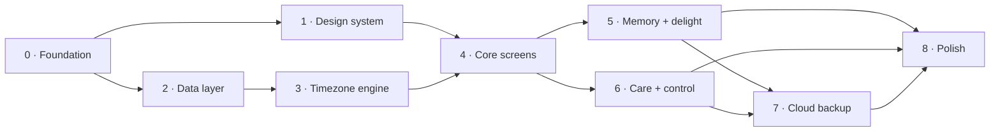

# 13 — Development Roadmap

Eight phases. Each has explicit exit criteria. **A phase is not done until its
exit criteria pass**, and no phase begins before the previous one closes.

The ordering is deliberate: the design system comes before any screen, and the
notification engine comes before the screens that depend on it. The riskiest
work (timezone correctness) is done early, not last.

## Current delivery status

| Phase | Repository status |
|---|---|
| 0 — Foundation | Complete; Flutter scaffold, fonts, linting, architecture guard, CI, and tests are present. Dev/prod flavors were deferred because no flavor-specific feature exists yet. |
| 1 — Quiet design system | Complete for the implemented token/theme foundation, gallery, and component set documented in the implementation report. Product-only components remain future work. |
| 2 — Core foundation | Complete for the scoped implementation: Drift schema v1, domain models, repositories, Riverpod infrastructure providers, persisted theme state, local image-store abstraction, router foundation, and a non-product application shell are present. |
| 3–8 | Not implemented |

The implementation record for the completed Phase 0–1 work is
[`../IMPLEMENTATION_PHASES_0_1.md`](../IMPLEMENTATION_PHASES_0_1.md). The app
now opens a Phase 2 foundation shell; the design gallery remains available at
`/gallery`. There is still no production product screen.

---

## Phase 0 — Foundation

**Status:** Complete. The foundation is recorded in the implementation report.
`dev` / `prod` flavors were proposed in the original plan but are not present
in the current Android or iOS projects; establish them before a flavor-specific
scheduling inspector or Firebase configuration is introduced.

**Goal:** a project that compiles, lints strictly, and enforces its own
architecture.

- Flutter project scaffold and package identifiers
- `very_good_analysis` plus the checked-in architecture guard with the current
  layer-boundary and design-integrity rules
- Guard rules: no `DateTime.now()` outside `core/clock.dart`; no `TextStyle`
  literals outside `design/`; no Material component imports in `features/`
- `build_runner` wiring, CI (analyze, test, format check, codegen freshness)
- Bundle Fraunces and Inter as variable font assets

**Exit:** CI green on an empty app. A deliberately-planted `ElevatedButton` in
`features/` fails the build.

---

## Phase 1 — The Quiet design system

**Status:** Complete for the implemented Phase 1 scope. The repository includes
the token/theme system, glyphs, gallery, goldens, and the actual component list
in the implementation report. It does not yet include `QDateField`, search,
settings, undo, note-card, gift-idea, or photo components; those are required
by later product phases.

**Goal:** the entire design language exists and is visually verified before a
single product screen is built.

- All token files (doc 04, 05, 06, 07)
- `QuietTheme` `ThemeExtension` with a complete, correct `lerp`
- Three themes: light, dark, AMOLED
- `QuietMotion` reduce-motion resolver
- The 12 glyphs as `CustomPainter`s
- Component tier 1 and the implemented tier-2 subset (`QSheet`,
  `QBottomActions`, `QField`, and `QNoteKindPicker`); `QDateField` remains
  required before the Add/Edit flow
- A component gallery rendering the implemented components and representative
  states; it is currently the app's default home because flavors and product
  routing do not yet exist
- Golden tests: the eight implemented gallery specimens × 3 themes × 2 text
  scales (48 committed baselines)

**Exit:** the gallery renders correctly in all three themes at 1.0× and 1.3×.
Goldens committed. Zero Material components in `design/components/`.

**Golden platform note.** Golden images are pixel-sensitive to the host font
rasteriser, so they are tagged `golden` in `dart_test.yaml`. The main CI job runs
`flutter test --exclude-tags golden` and a separate job compares goldens on
`ubuntu-latest`, which is the reference platform. Baselines committed from a
different OS will need one regeneration on that platform:
`flutter test --tags golden --update-goldens`.

---

## Phase 2 — Data layer

**Status:** Complete for the scoped Phase 2 foundation requested after the
Phase 0–1 build. The repository now includes:

- Drift schema v1 with the tables from doc 10
- Seeded default reminder rules and a typed single-row `settings` table
- Domain models for people, notes, reminder rules, settings, location, and
  timezone
- Drift-backed repository implementations for people, notes, and settings
- Riverpod infrastructure providers for the database, repositories, image store,
  and settings stream
- Persisted appearance state wired through the settings repository
- A local image-store abstraction using content-hash file naming
- `go_router` foundation and a non-product application shell

The following hardening items from the original target design remain future
work and should be revisited before shipping schema v2+: Drift schema dumps and
generated migration verifiers, fake repositories for test isolation, and any
generator/toolchain upgrade beyond the current Dart 3.10-compatible setup.

**Goal:** persistence is complete and provably migratable before any UI reads it.

- Drift schema v1, all tables from doc 10
- Repository implementations
- Domain models
- Schema versioning and migration strategy
- Photo file store with content-hash naming and orphan sweep
- Seed the default reminder rules on create

**Exit:** repository unit tests pass against in-memory Drift, analyzer and the
architecture guard are clean, and the app can boot into a non-product shell
from persisted settings and the new router foundation.

---

## Phase 3 — The timezone and scheduling engine

**Goal:** the hardest correctness problem, solved and tested, before it has any
UI depending on it.

- `OccurrenceCalculator`, `ReminderPlanner`, `NotificationComposer` — pure Dart
- Injected `Clock`; device timezone as a parameter
- Bundled offline city → IANA dataset (trimmed GeoNames, target < 400KB)
- `NotificationService` wrapper + `FakeNotificationService`
- `ScheduleReconciler` with the platform-budget horizon
- Android manifest, receivers, channels; iOS delegate and categories
- The full timezone test matrix from doc 09 §7
- Scheduling inspector screen (dev flavour)

**Exit:** the timezone matrix passes — including 29 February, both DST
transitions, 30- and 45-minute offset zones, and the antimeridian pair
(Kiritimati / Niue). Reconciliation is proven idempotent by a property test.

---

## Phase 4 — Core screens

**Goal:** the product is usable end to end, offline, with no account.

- S2 Home with grouping and T4 choreography
- S3 empty state
- S4 Person
- S6 Add person, S7 Edit, S9 Place picker
- S1 Welcome
- T1 shared-element transition, T2 sheets, T5 row insert/remove
- Contextual permission prompt (doc 11 §6)
- Notification deep linking, warm and cold

**Exit:** add a person, receive a real scheduled notification on a physical
device in a different timezone, tap it, land on their profile with the correct
back stack. Home scrolls at 120Hz with 200 people, verified in profile mode.

---

## Phase 5 — Memory and delight

**Goal:** the emotional layer — the reason the product exists.

- S8 Note editor, `QNoteCard`, `QGiftIdeaRow`, note kinds
- Note-weaving in notification copy, with rotation and the privacy rules
- S10 photo pipeline: pick, crop to superellipse, compress, store
- S5 Today and the T9 birthday moment
- T8 photo viewer with drag-to-dismiss
- Monogram avatars with deterministic tints

**Exit:** a notification arrives carrying a remembered detail that the user
saved weeks earlier. The core loop from doc 01 is closed and demonstrable.

---

## Phase 6 — Care and control

**Goal:** the app is trustworthy and finishable.

- S12 Settings, S14 Recently removed, `QUndoBar` everywhere
- Soft-delete retention job and photo orphan sweep
- JSON + photos export/import archive
- Full accessibility pass: TalkBack/VoiceOver walkthrough of every screen,
  Dynamic Type to 200%, reduce-motion verification
- Contrast assertions as golden tests
- Android OEM battery-optimisation explainer

**Exit:** a full VoiceOver and TalkBack pass with no unlabelled controls and no
trapped focus. Export → wipe → import restores everything, photos included.

---

## Phase 7 — Optional cloud backup

**Goal:** backup exists and is genuinely optional.

- Google Sign-In + Firebase Auth
- Firestore mirror, Storage for photos
- Push/pull with LWW merge and tombstone propagation
- Clock-safety guard on `updated_at`
- S13 Backup screen with honest, quiet status
- Sign-out that preserves local data

**Exit:** install on a second device, sign in, and the full dataset arrives.
Airplane-mode edits on both devices converge correctly on reconnect. Signing out
deletes nothing locally.

---

## Phase 8 — Polish and release

**Goal:** ship.

- Performance traces in CI for home scroll and T1
- Cold start under 400ms to first meaningful paint
- App icon, splash, store assets in the Quiet language
- Privacy policy stating plainly that nothing leaves the device without sign-in
- Release signing, obfuscation, split debug info
- Beta with 10–20 real users across at least three timezones

**Exit:** the one-screenshot test (doc 03) passes with people who build apps.
Zero P0 bugs from beta. Notification delivery verified on iOS and on at least
two problematic Android OEMs.

---

## Dependency graph

Phases 1 and 2 can run in parallel. Phases 5 and 6 can run in parallel.

---

## Risk register

| Risk | Impact | Mitigation | Phase |
|---|---|---|---|
| Notifications silently dropped on Android OEMs | Product fails at its one job | Early physical-device testing; OEM explainer; inexact fallback | 3, 6 |
| iOS 64-notification cap hit | Distant birthdays never fire | Rolling horizon with headroom, proven by test | 3 |
| Timezone edge cases wrong | Silent, embarrassing, hard to notice | Pure functions + exhaustive matrix, built before the UI | 3 |
| Design system drifts into Material | Loses the entire product thesis | Lints, the gallery, goldens, the one-screenshot test | 1, 8 |
| Scope creep into CRM territory | The product stops being calm | The permanent "never" list in doc 01 | all |
| Variable fonts inflate bundle size | Slower install, larger app | Subset to Latin; measure in Phase 1 | 1 |
| Firebase becomes a dependency for core use | Breaks the offline-first promise | Backup is a leaf feature; the app is complete at Phase 6 | 7 |

---

## What "v1 complete" means

The app is releasable at the **end of Phase 6**, without cloud backup. That is
intentional: Kin's promise is that it works with no account, and a version that
ships without Firebase proves that promise is real rather than aspirational.

Phase 7 is an enhancement, not a requirement.

---

## Immediate next step

**Phase 2 — Data layer.** Before starting it, select a Flutter/Dart and
generator-version strategy compatible with the repository's SDK constraint.
Then implement the Drift schema, domain models, repositories, migration test
harness, and photo file store without introducing product screens.
